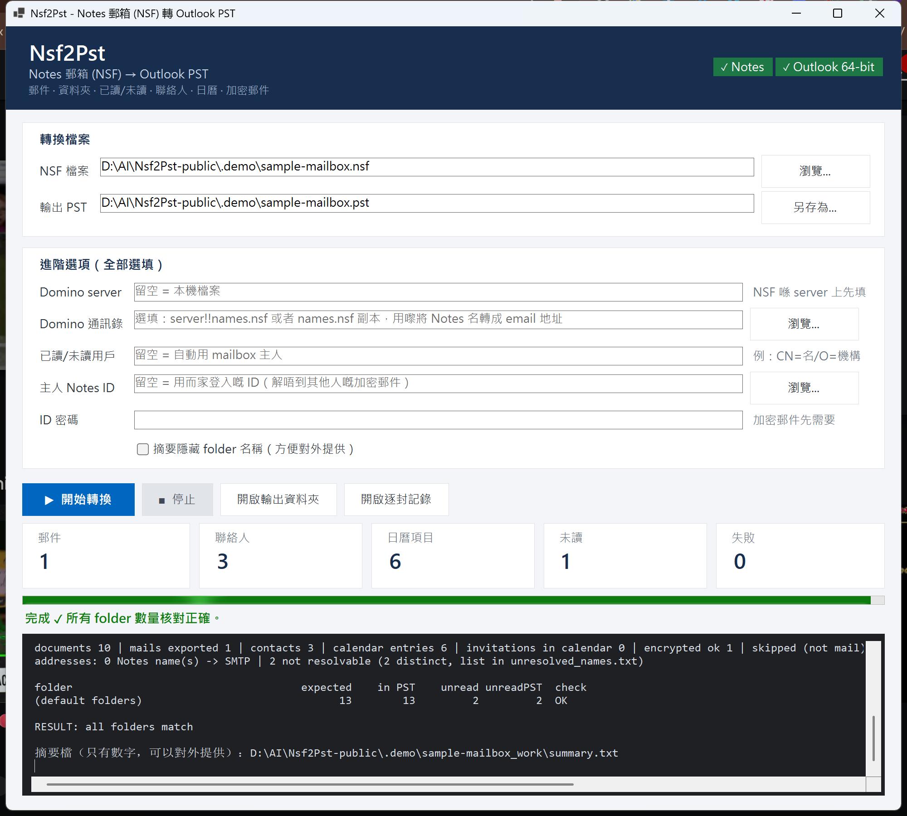
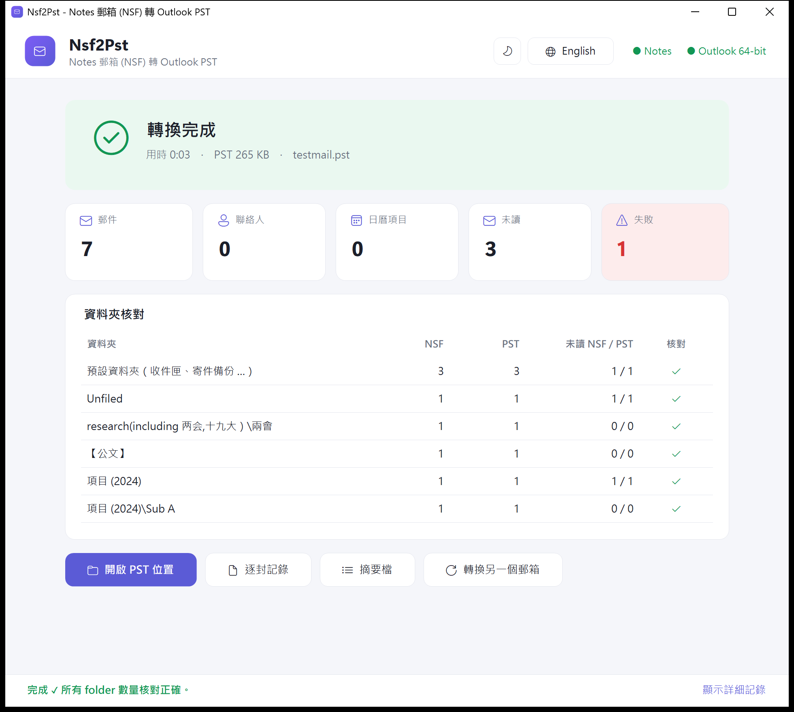
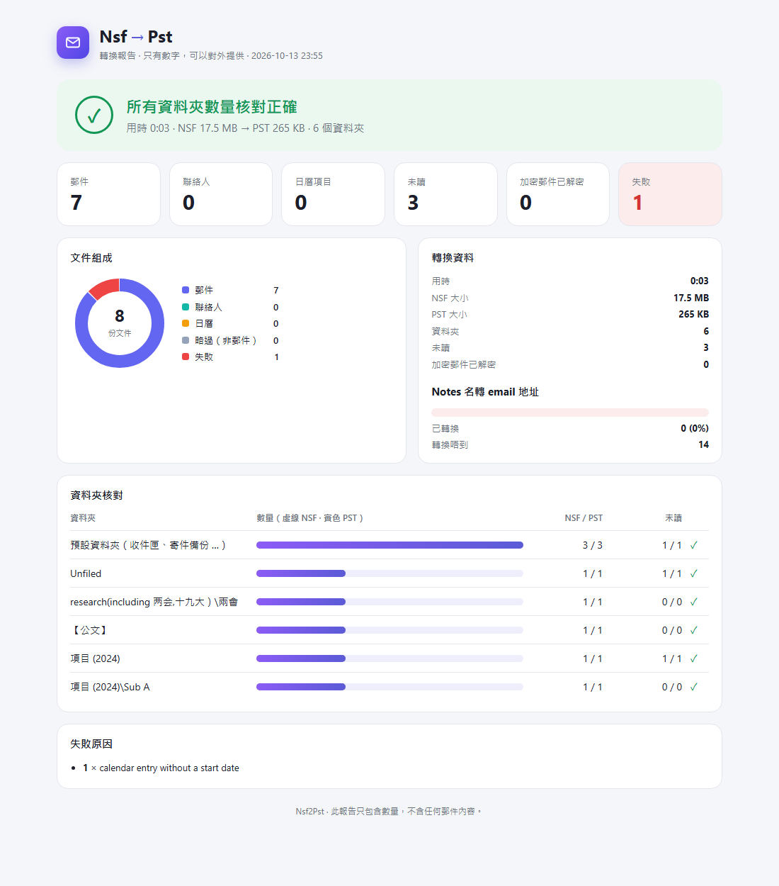

# Nsf2Pst

Converts HCL Notes / Lotus Notes mail files (`.nsf`) into Outlook data files (`.pst`) on a Windows PC that has both
a Notes client and Outlook installed. One window, one button: pick the NSF, pick the PST, press **Start**.
It also converts the other way, **PST → NSF**, into a new Notes mail file (mail, attachments, folders, read / unread).

It was written to fix problems seen with an existing migration tool:
Traditional Chinese subjects turning into `???`, folders with brackets in their names ending up in "Unfiled",
and read / unread marks being lost.



*The window is available in English and Traditional Chinese, with light and dark themes (both follow Windows and can be
switched in the title area). The screenshots show a generated sample mailbox with fictional data.*



## Features

| Area | What is converted |
|---|---|
| Mail | Every mail-type document (Memo, Reply, invitations / notices, delivery reports ...), with attachments |
| Folders | The full folder tree, including names with `( ) [ ] 【 】`; Inbox / Sent / Drafts / Deleted / Junk map to Outlook's default folders; mail that is in no folder goes to `Unfiled` |
| Read / unread | Taken from the Notes unread table of the **mailbox owner** (not of the ID that runs the tool) |
| Unicode | Subjects and attachment names are taken from Notes as Unicode; mail bodies that Notes converts with a lossy charset (e.g. ISO-2022-JP for Traditional Chinese) are rebuilt from the Notes text |
| Contacts | Notes contacts (Person documents) become Outlook contacts: names, e-mail, company, phones, address; other fields go into the notes |
| Calendar | Appointments, all-day events, meetings, reminders and anniversaries; repeating entries become one appointment per occurrence; unanswered invitations that Notes shows in its calendar get a *tentative* appointment |
| Encrypted mail | Decrypted with the mailbox owner's Notes ID (optional ID file + password); body and attachments are rebuilt from the decrypted document |
| Addresses | Internal Notes names (`Alex_Chan/Sales/ExampleCorp`) are replaced with SMTP addresses so that replies work. The name -> address table is learned from the mail file itself (recipient lists, `INetFrom`, contacts); an optional Domino directory (`names.nsf`) fills the gaps |
| Verification | After each run the number of items and unread items per folder is compared between the NSF and the PST; a numbers-only `summary.txt` can be shared without exposing mail content |

## Requirements

- Windows 10 / 11, x64
- **64-bit HCL Notes client** (the tool uses `nnotes.dll` and the Notes COM classes; Notes must be set up with a user ID)
- **64-bit Outlook** (Microsoft 365 Apps / Outlook 2016 or later; the tool uses Extended MAPI from `OLMAPI32.DLL`)
- To build: [.NET 8 SDK](https://dotnet.microsoft.com/download)

Both programs must be licensed on the machine; the tool only calls their APIs and ships none of their files.

## Build

```powershell
cd src\Nsf2Pst
dotnet build -c Release
# single self-contained exe (no .NET install needed on the target PC):
dotnet publish -c Release -r win-x64 --self-contained -p:PublishSingleFile=true -p:EnableCompressionInSingleFile=true -o ..\..\publish
```

## Usage

### Window

Start `Nsf2Pst.exe` without arguments. Drop an `.nsf` file on the window or press Ctrl+O to choose one.

1. **NSF file**: the mail file. **Work on a copy**; Notes updates view indexes inside the file it opens.
2. **Output PST**: a new file (an existing PST is never appended to).
3. Optional settings:
   - **Domino server**: if the NSF is opened from a server.
   - **Domino directory**: `server!!names.nsf` or a copy of `names.nsf`, used to resolve Notes names that the mail file
     does not reveal.
   - **Read/unread user**: leave empty to use the mailbox owner.
   - **Owner Notes ID** + **password**: only needed for encrypted mail.
   - **Hide folder names in summary**: for sharing `summary.txt`.
4. Press **Start** (or Enter). The window shows the three steps (export, write PST, verify), the percentage and an
   estimate of the remaining time; the taskbar button shows the progress too. At the end it shows the counts and a
   per-folder check. The work folder `<pst name>_work` next to the PST holds the per-document log
   (`export_log.csv`), `summary.txt`, the visual report `summary.html` and `unresolved_names.txt`.

   `summary.html` is a single self-contained page (no scripts, no external files, light / dark) with the same numbers
   as `summary.txt`: totals, what the NSF contained, address resolution and a NSF-vs-PST bar per folder. Like
   `summary.txt` it contains no mail content, and folder names are hidden when that option is on.

   

### Command line

The window runs the same exe in three steps; they can be called directly:

```powershell
Nsf2Pst.exe export <mail.nsf> <workdir> [--server S] [--user "CN=..."] [--id owner.id] [--directory server!!names.nsf]
Nsf2Pst.exe import <out.pst> <workdir>\manifest.jsonl
Nsf2Pst.exe counts <out.pst>        # folder <TAB> items <TAB> unread
Nsf2Pst.exe list   <out.pst>        # folders and items, for checking
```

Passwords are read from environment variables, never from the command line:
`NOTES_PASSWORD` (password of the ID Notes is set up with) and `NOTES_ID_PASSWORD` (password for `--id`).

### PST -> NSF (the other direction)

Switch the window to **PST → NSF** (or drop a `.pst` file on it). A new Notes mail file is created from the Notes mail
template (`mail12.ntf`, or the newest `mailNN.ntf` in the Notes data folder) and filled from the PST:

| Area | What is converted |
|---|---|
| Mail | Every message of the mail folders, with attachments, as native MIME (written by Outlook's own MAPI -> MIME converter, always as UTF-8, and parsed by Notes' MIME API) |
| Folders | The PST folder tree; Inbox -> `($Inbox)`, Sent Items -> Sent view, Drafts / Outbox -> Drafts, Junk -> `($JunkMail)`, Deleted Items -> folder `Deleted Items`. Mail that NSF -> PST had put into `Unfiled` (mail in no Notes folder) goes back to no folder |
| Read / unread | Per message, written to the unread table of the mailbox owner (option *Read / unread user*, default: the current Notes user) |
| Exchange addresses | Mail from Exchange accounts stores sender / recipients as X.500 (`EX`) addresses; the SMTP addresses the PST keeps next to them are used instead |
| Meeting requests, reports | Messages Outlook's converter refuses (e.g. meeting requests, delivery reports) are rebuilt from their MAPI properties: subject, sender, recipients, date, body, the meeting's time and place, attachments |
| Contacts | Outlook contacts -> Notes contacts (Person documents): names, e-mail, company, phones, business address, notes. Contact groups -> Notes personal groups (members as Internet addresses) |
| Calendar | Appointments, all-day and multi-day events, reminders, private entries and repeating appointments (daily / weekly / monthly incl. "2nd Tuesday" and "last day" / yearly patterns, deleted occurrences, no end date), created with the Notes calendar API (`CalCreateEntry`). Attendees are kept as text in the description, so no invitations are sent. Changed single occurrences of a series keep the series' time; a series without an end date is expanded by Notes for about 10 years |
| Tasks | Outlook tasks -> personal Notes to dos (start, due, completed, progress, importance) |
| Notes, journal | Sticky notes and journal entries are kept as documents in a folder of the same name |
| Verification | Items and unread items per folder, PST vs NSF, in `summary.txt` / `summary.html` like the other direction |

```powershell
Nsf2Pst.exe pst-export      <in.pst> <workdir>                       # EML files + manifest.jsonl (Outlook side)
Nsf2Pst.exe nsf-import      <new.nsf> <workdir>\manifest.jsonl [--server S] [--user "CN=..."] [--template mail12.ntf]
Nsf2Pst.exe nsf-mark-unread <new.nsf> <workdir>\unread_ids.txt     # separate step, see below
Nsf2Pst.exe nsf-counts      <new.nsf>                                # folder <TAB> items <TAB> unread
```

The unread marks are written by their own process that uses only the Notes C API: a process that uses the Notes COM
classes cannot shut Notes down cleanly, so an unread table written there would not reach the disk.

`Nsf2Pst.exe pst-make-test <pst>` adds fictional test items that NSF -> PST never creates (a repeating appointment, a
mail with Exchange addresses, a task, a sticky note, a journal entry), for testing this direction.
`Nsf2Pst.exe pst-make-uat <pst>` adds a wider fictional set: every supported repeat pattern, a private appointment, a
multi-day event, a meeting with attendees, completed / undated tasks, a contact group, a meeting request and a delivery
report.

## How it works

- **Export** (Notes side): `MIMEEMLExport` from the Notes C API writes each mail as `.eml`; MimeKit then fixes
  subjects, attachment names, lossy bodies and addresses. Folders, contacts and calendar entries are read through
  the Notes COM classes; unread marks through `NSFDbGetUnreadNoteTable`.
- **Import** (Outlook side): a temporary MAPI profile opens the PST. Mail goes through Outlook's own
  `IConverterSession::MIMEToMAPI`; contacts and appointments are written as MAPI properties. The temporary profile is
  deleted at the end.
- The two sides run as separate child processes of the same exe, so the Notes and Outlook libraries never share a
  process.
- `--id`: the tool backs up `notes.ini`, switches to the given ID (`SECKFMSwitchToIDFile`) and restores `notes.ini`
  afterwards, also after an interrupted run.

## Limitations

- Output is a PST file only; it does not write to Exchange / Microsoft 365 directly.
- Repeating Notes entries become separate appointments, not an Outlook recurring series. Time zones are taken from
  the converting PC.
- Meeting attendees are written into the appointment body, not as Outlook meeting attendees.
- Rebuilt bodies (only for mail Notes converts lossily) are plain text: tables and colours are lost.
- NSF -> PST does not convert: mail rules, signature, out-of-office message, contact groups, to-dos, Notes categories.
- No resume / incremental mode: an interrupted run starts again with a new PST.
- Disk space: the work folder holds every mail as an EML file, so allow free space of about 2.5 times the mailbox
  size next to the output file. Tested up to 18,000 mails and a 2 GB PST (PST -> NSF: about 2 minutes, under 300 MB
  memory per step).
- Notes cannot open databases whose path is longer than about 250 bytes (a Chinese character takes 3 bytes); the
  window checks this before it starts.
- A stopped or failed run renames its half-written output to `<name>_incomplete_<time>.pst/.nsf`.
- Tested with a handful of real mailboxes up to about 800 MB. Test with your own mailboxes before relying on it.

## Tests

`tests\` contains PowerShell scripts (Windows PowerShell 5.1, 64-bit, Notes set up) that build sample mail files
from `mail12.ntf` with fictional data:

| Script | Creates |
|---|---|
| `make_test_mailbox.ps1` | Mail with Unicode subjects, attachments, bracketed folders, unfiled mail |
| `make_pim_mailbox.ps1` | Contacts, calendar entries (single, all-day, meeting, repeating, reminder) and an encrypted mail |
| `make_stress_mailbox.ps1` | Many mails over many folders, for volume tests |
| `add_test_calendar.ps1` | Adds calendar entries to a **copy** of an existing mail file |
| `gui_autotest.ps1` | Fills in the window through UI Automation, presses Start and prints the log (optionally a screenshot) |

```powershell
.\tests\make_test_mailbox.ps1 -Out C:\temp\nsf2pst-test\sample.nsf
.\tests\gui_autotest.ps1 -Exe .\publish\Nsf2Pst.exe -Nsf C:\temp\nsf2pst-test\sample.nsf -Pst C:\temp\nsf2pst-test\sample.pst
```

## Privacy

The tool works offline and sends nothing anywhere. Passwords are passed through environment variables only and are
not written to logs. The work folder contains the exported mail (`.eml`) and should be deleted after checking.

## Acknowledgements

Developed with the help of an AI coding assistant (Claude). Uses [MimeKit](https://github.com/jstedfast/MimeKit)
(MIT licence).

HCL Notes is a trademark of HCL Technologies; Outlook is a trademark of Microsoft. This project is not affiliated
with either.

## Licence

[MIT](LICENSE)
